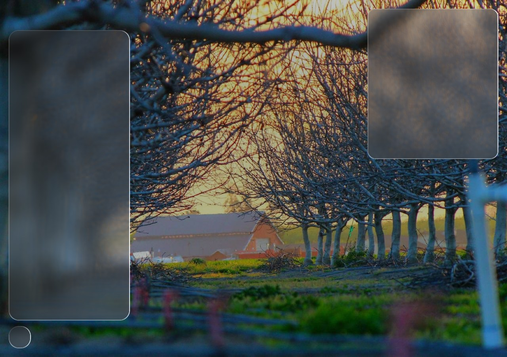

# Liquid Glass

A single-file WebGL2 implementation of the "liquid glass" material — the thing Apple ships in
iOS 26 — written from scratch with no libraries and no build step. Every pane, button, slider
handle and sheet on the page is the same fragment shader.

Open `index.html` in a browser. That's the whole install.



*The canvas layer alone. The labels and sliders are DOM painted on top; this is what the shader
produces underneath them.*

```
liquid-glass/
├── index.html      the shader, the page, the controls
└── img/            four photo backdrops
```

---

## Contents

- [The idea in one paragraph](#the-idea-in-one-paragraph)
- [1. The shape: a tray, not a lens](#1-the-shape-a-tray-not-a-lens)
- [2. The material: refraction, dispersion, fill](#2-the-material-refraction-dispersion-fill)
- [3. Frost: a flat plane](#3-frost-a-flat-plane)
- [4. Drawing: one surface per draw call](#4-drawing-one-surface-per-draw-call)
- [5. Layering glass over DOM content](#5-layering-glass-over-dom-content)
- [6. Chrome: sliders made of the same material](#6-chrome-sliders-made-of-the-same-material)
- [Pitfalls: symptom → cause → rule](#pitfalls-symptom--cause--rule)
- [For agents: the non-negotiables](#for-agents-the-non-negotiables)
- [Controls](#controls)
- [Performance](#performance)

---

## The idea in one paragraph

Glass is not a blur. A blur has no edge, no depth and no direction. Glass is a **solid with a
curved edge**: light passing through the middle is barely deflected, light passing near the rim is
bent hard, and the rim catches the light sources as a thin bright line. So you do not blur a
rectangle — you displace your sampling coordinate by the **gradient of a height field** that is
flat in the interior and falls off over a fixed band at the edge, then add a specular rim. Everything
else in this file (frost, dispersion, lights, the two-canvas layering) decorates that one idea.

---

## 1. The shape: a tray, not a lens

The first version of this shader displaced the backdrop along the **gradient of the distance field**.
It looked like a lens, and it had a fatal flaw: down the centre of any long shape the "nearest edge"
direction flips across the medial axis, so the displacement reverses and prints a **seam — a spine**
straight down the middle of the pill.

The fix is to stop using the distance field as the surface. Use a **height field**:

```glsl
float sdr(vec2 p, vec2 b, float r){          // rounded-rect signed distance
  vec2 q = abs(p) - b + r;
  return length(max(q,0.0)) + min(max(q.x,q.y),0.0) - r;
}

float shortSide = min(b.x, b.y);
float bevelW    = min(uBevelPx*uPxP, shortSide*0.45);   // width of the fillet
float s         = clamp(-dSmooth/bevelW, 0.0, 1.0);     // 0 at the outer edge, 1 at the plateau
float prof      = pow(max(sin(s*PI), 0.0), uCurve);     // the fillet's cross-section
float push      = min(uDepth, bevelW*0.26/max(uCurve,1.0)) * prof;
```

Three consequences, all of them the point:

- **The interior is exactly flat.** `prof` is 0 across the whole plateau, so displacement there is
  0 — not small, *zero*. Nothing in the middle can crease, because nothing in the middle is doing
  anything.
- **`uCurve` sets how the fillet meets the plateau.** Exponent 1 leaves at a linear slope and looks
  like a chamfer; 2 and up leave with zero slope, so the join is smooth (C1/C2) and the pane reads as
  one curved sheet rather than a beveled box.
- **`dSmooth` is a 5-tap blurred distance field.** The sharp SDF still has a hint of the medial axis
  in it; blurring it before taking the profile stops that from modulating the fillet width.

The push is **capped** at `bevelW·0.26/curve`. This is not cosmetic: displacement is a *translation*
of the sample coordinate, and past a certain amplitude the map stops being monotonic — neighbouring
pixels sample in reverse order and the rim corrugates into a fold. If you widen the bevel or increase
depth, re-derive that cap rather than raising it.

> **This is what a baked displacement map does too.** Normal maps for glass are neutral grey in the
> middle and carry values only inside a fixed-width band at the edge. Same model, one texture instead
> of one function. If you are doing this in CSS with `feImage` + `feDisplacementMap`, the map is a
> rounded rectangle of horizontal gradient inside the rim band and flat grey inside.

---

## 2. The material: refraction, dispersion, fill

Sampling the backdrop through the displacement:

```glsl
vec2 duv  = vec2(-n.x/a, -n.y) * push;   // bend inward, aspect-corrected
vec2 base = uv + duv;
```

`n` is the SDF normal, and it is only trustworthy **near the rim**. Deep inside a long shape it flips
across the medial axis, so it is never used for anything except this thin band and the specular.

**Dispersion.** Real glass refracts red and blue by different amounts. The offset must be **radial
about the optical centre**:

```glsl
vec2 cab = (base - 0.5) * 0.0018;        // zero at the centre, grows toward the edges
o.r = bg(base + cab).r;
o.g = bg(base).g;
o.b = bg(base - cab).b;
```

Scaling the coordinate instead (`uv*1.0016`) offsets about the *origin*: the error grows with
distance from the top-left corner, clamps at the border, and paints rainbow streaks along the canvas
edge that look exactly like a bug in the blur.

**Fill.** Pure refraction over a busy photo is unreadable where text sits on top. `uFill` mixes a
cool white-blue into the pane (`mix(o, vec3(0.87,0.91,1.0), fill)`). Keep it low — 4–5% is enough to
lift text; 10%+ starts to look like frosted plastic rather than glass.

**Lights.** Two directional lights, movable, each with an angle and an intensity:

```glsl
float key   = pow(max(dot(n, uLA), 0.0), 1.35) * 1.45 * uIA;
float sec   = pow(max(dot(n, uLB), 0.0), 1.20) * 0.95 * uIB;
float glint = pow(max(dot(n, uLA),0.0), 14.0)*uIA + pow(max(dot(n,uLB),0.0),14.0)*uIB*0.6;
```

The rim highlight is **tinted with the backdrop's own colour** and given a small per-channel spread,
so it is never flat white:

```glsl
float spread = 1.0 + 0.14*uCA;
vec3 rimTint = mix(vec3(0.97,0.98,1.0), clamp(o*2.0,0.0,1.0), 0.75*uCA);
o += rimTint * vec3(1.0-exp(-hi*spread), 1.0-exp(-hi), 1.0-exp(-hi/spread));
```

One rule that cost a lot of debugging: **never use the SDF normal for broad shading.** Any term that
covers a whole pane — a diffuse lift, a gradient, a "light from above" wash — will print the corner
bisectors of the rounded rectangle as an X or an hourglass, because the nearest-edge field is
discontinuous along them. Broad shading uses a linear ramp across the shape
(`vec2 np = pl/b`), and the SDF normal stays inside the rim band.

---

## 3. Frost: a flat plane

Frosting has nothing to do with curvature. It is what happens *through* the pane, so it must not be
parameterised by the shape at all:

```glsl
float fr = uFrost * uFrostPx * uPxP;          // constant radius, no distance-field term
vec3 c0 = bgFrost(uv, fr, uFrost*uFrostLod);  // sampled at the UNDISPLACED uv
```

Four separate mistakes live in those two lines:

1. **Radius × distance field.** Scaling the kernel by `smoothstep(0,depth,d)` makes the blur follow
   the bevel and draws bands along it.
2. **Sample at the displaced uv.** Sampling the blur through the refraction smears it along the edge.
3. **Mips alone.** A coarse mip level upsampled bilinearly is a grid of huge interpolated quads —
   visible as **diagonal facets** across the pane, not as a blur.
4. **A lod argument that never reaches `textureLod`.** A backdrop helper that returns
   `textureLod(tex, uv, 0.0)` regardless of its lod parameter makes every blur tap a *sharp* sample:
   the disc then paints a rosette of the underlying detail that reads as streaky seams.

The blur that works is a **16-tap golden-angle disc over a pre-blurred mip**:

```glsl
float ilod = clamp(log2(max(rad*uRes.y,1.0)) - 1.9, 0.0, 3.5);  // ~1 texel per tap
vec3 s = bg(uv, ilod);
for(int i=0;i<15;i++){
  float fi = float(i)+0.5;
  float a  = fi*2.39996;                 // golden angle: no visible rings
  float rr = sqrt(fi/15.0)*rad;          // even coverage of the disc
  s += bg(uv + vec2(cos(a)/aspect, sin(a))*rr, ilod);
}
```

**Frost does three things, and they must be one slider**:

- **Blur** — the disc above.
- **Chroma drain.** Blur removes high-frequency contrast while flat colour regions survive, so
  chroma appears to *increase*. Mix toward luma on a curve:
  `mix(o, vec3(lum), clamp(sqrt(f)*0.62 + 0.22*f, 0.0, 1.0))` with Rec.709 weights.
- **Scatter lift.** A frosted pane catches light on the side facing a lamp:
  `o += lightColour * frost * k * faceLit`, where `faceLit` is a **linear ramp across the shape**
  (never the SDF normal — see above).

---

## 4. Drawing: one surface per draw call

The first working version looped over an array of surfaces inside the fragment shader. That is a trap:

- every pixel pays for every surface, because `glass()` gets inlined once per iteration;
- 24 surfaces was enough to lose the WebGL context outright on a software renderer.

Draw each surface as its **own scissored draw call** instead:

```js
gl.enable(gl.SCISSOR_TEST);
gl.scissor(x0, y0, x1-x0, y1-y0);
gl.uniform4f(U.panel, cx, cy, hx, hy);   // this surface, in p-space
gl.drawArrays(gl.TRIANGLES, 0, 3);       // one full-screen triangle
```

Two details that are easy to get wrong:

- **`discard` outside the shape.** The scissor is a *rectangle*; without `if(cov <= 0.002) discard;`
  the corners of the box re-composite a sharp backdrop over whatever was painted underneath, which
  shows up as dark squares around small overlay elements.
- **Clip children to their scroll container.** A shader-drawn knob inside an `overflow:auto` panel
  still has a viewport rect when it scrolls out, so it keeps painting glass over the page. Intersect
  each child's device-pixel box with the container's, and skip the draw when the intersection is
  empty.

Painter order is explicit: list surfaces big-to-small and draw in order. The list *is* the z-order.

---

## 5. Layering glass over DOM content

This is the part that decides whether the whole thing feels real, and it is an architecture question,
not a shader question.

**The constraint.** One canvas sits behind all the DOM. A shader can only blur what it can sample, and
it cannot sample the DOM. So glass drawn in that canvas can never blur *text* rendered above it — the
text sits on top and stays perfectly sharp no matter how frosted the glass is. Conversely, any CSS
`backdrop-filter` above the canvas blurs **everything beneath the element**, which includes the
canvas — so the glass blurs its own rim, its bevels and its handles.

You cannot have both with one canvas. You need a **depth band**:

| z | layer | what lives there |
|---|---|---|
| 0 | `#gl` canvas | backdrop photo + the panels that sit *under* other panels |
| 6 | card DOM | the text of those panels |
| 7 | `#frost` div | `backdrop-filter: blur(...)` — blurs the text behind the sheet |
| 8 | `#glf` canvas | the sheet's own glass: pane, handles, buttons |
| 9 | sheet DOM | the sheet's labels and sliders |
| 10 | floating buttons | icons above their own glass |

The front canvas draws with `uOverlay = 1`, which changes what `main()` outputs:

```glsl
if(uOverlay > 0.5){ col = glassColour; outA = cov * uAlpha; }  // glass only, translucent
else             { col = mix(backdrop, glassColour, cov*uPanelA); }
```

`uAlpha ≈ 0.9` keeps ~10% of the blurred layer visible through the pane, so it still reads as
translucent glass instead of an opaque card. **That alpha is what sells it.**

Two more pieces make it behave:

- **Position the blur layer to the sheet, and only enable it on real overlap.** On desktop the panels
  never overlap; the layer stays at `opacity:0` and the view is pixel-identical to the single-canvas
  build.
- **Fade the sheet's backdrop when it opens.** A card behind the sheet should step back — smaller,
  dimmer, out of focus — and its *glass* must fade with it. The shader reads each surface's computed
  `opacity` every frame and uses it as `uPanelA`, so CSS transitions and canvas glass stay in lockstep.

**How many canvases?** One per depth *band*, not per layer. Two covers almost every UI (content
below, chrome above); three if a sheet can open over a sheet. Each canvas is a separate WebGL context
(memory, and mobile browsers cap live contexts around 8–16), and each `backdrop-filter` is a
full-screen readback per frame. For more layers than that, move the blur into the shader — render the
scene to an offscreen framebuffer, blur it once into a texture, and let each glass layer sample it —
which costs the DOM text but scales without limit.

---

## 6. Chrome: sliders made of the same material

A slider is a DOM `<input type=range>` with an **invisible native thumb** (still hit-testable) plus a
positioned element that the shader paints glass into:

```css
input[type=range]::-webkit-slider-thumb{ background:transparent; border:0; }  /* keeps the hit area */
.slider .knob{ position:absolute; width:34px; height:22px; border-radius:99px; }
```

The knob is a **capsule**, so the shader's corner radius must be allowed to equal half the short side
(`r = min(uPanelR, min(b.x,b.y))`) — a `0.92` safety cap makes it a rounded rect that never quite
looks like a pill.

Two geometry traps:

- **The thumb cannot reach the track's ends.** The centre is `17px + (100% − 34px)·u`, not `u·100%`.
  Use that one expression for the track's fill stop *and* the knob's position, or the white line ends
  a few pixels away from the bead.
- **The input sits a couple of pixels inside its wrapper** (UA margin). Measure the input's rect in
  JS and write the knob's position in pixels; do not trust `%` in two different containing blocks.

The track's white fill runs to the thumb's centre and terminates in a small dot — the dot is DOM, so
it stays crisp above the glass.

---

## Pitfalls: symptom → cause → rule

| Symptom | Cause | Rule |
|---|---|---|
| Seam / spine down the middle of a long shape | displacement from the SDF gradient flips across the medial axis | displace by a height field with a flat plateau; use the SDF normal only in the rim band |
| Rim corrugates / folds | push exceeded the monotonic limit of the sample map | cap push at `bevelW·0.26/curve` |
| Rainbow streaks along the canvas edges | chromatic offset by scaling the uv (offsets about the origin) | offset radially about `uv = 0.5` |
| Diagonal facets in a frosted pane | bilinear upsampling of a coarse mip | 16-tap disc over a pre-blurred level |
| Streaky rosette in a frosted pane | the blur helper dropped its lod argument, so every tap was sharp | verify the lod actually reaches `textureLod` |
| Bands following the bevel | frost radius / lod scaled by the distance field | frost is a flat plane: constant radius, constant lod, undisplaced uv |
| Frost looks like a blurry photo | blur without chroma drain and scatter | one slider: blur + desaturate + lit-side lift |
| X / hourglass across a frosted pane | broad shading driven by the SDF normal (corner bisectors) | shade broad areas with a linear ramp across the shape |
| Dark squares around small overlay glass | scissor box corners re-composite the backdrop | `discard` outside the shape's coverage |
| Glass keeps painting after scrolling out of its panel | the canvas is fixed, the element's rect is not clipped | intersect with the scroll container's box each frame |
| The sheet blurs its own rim and handles | `backdrop-filter` on the element blurs the canvas beneath it | front canvas above the DOM, blur layer between them |
| Text behind glass stays perfectly sharp | the canvas is below the DOM and cannot sample it | put the blur above the text and the glass above the blur |

---

## For agents: the non-negotiables

If you are extending this file, these are the invariants. Breaking one produces something that looks
almost right, which is worse than broken.

1. **Displacement comes from a height field with a zero-weight plateau**, never from the raw SDF
   gradient.
2. **The SDF normal is used only inside the rim band** — specular and thin displacement. Never for
   diffuse or any full-surface shading.
3. **Frost is parameterised by frost alone.** Constant kernel radius, constant mip level, sampled at
   the undisplaced uv.
4. **Dispersion offsets radially about `uv = 0.5`.**
5. **One glass surface per draw call**, scissored to its box, with `discard` outside its coverage.
6. **Surfaces inside a scrolling container are clipped to it** every frame.
7. **The painter order of the surface list *is* the z-order** — keep it in step with the CSS
   `z-index` values.
8. **Glass that must stay crisp sits on a canvas above the blur layer**, not below it.
9. **`uAlpha < 1` on the front canvas** — an opaque front canvas kills the illusion of depth.
10. **Every new control must be a URL parameter too** (`?frost=`, `?recede=`, `?sheet=`, `?dpr=`,
    `?still=`, `?lite=`). It is the only way to hand a look to someone else or to reproduce a bug.

Verification habits that paid for themselves here:

- `?still=1` renders one frame — cheap for screenshots and for comparing two settings.
- Read back computed values (opacity, filter, knob offsets) instead of eyeballing a screenshot;
  transitions make an immediate read lie.
- `node --check` on the extracted script catches the self-inflicted bracket errors before the browser
  does.

---

## Controls

Every knob is exposed both in the drawer and as a query parameter.

| Param | Range | Default | What it does |
|---|---|---|---|
| `rim` | 0.5–8 px | 2.0 | width of the specular band |
| `dep` | 0–0.12 | 0.074 | refraction depth |
| `bevel` | 4–90 px | 29 | plateau→bevel width (the "tray") |
| `curve` | 0.5–4 | 2.0 | fillet profile exponent |
| `frost` | 0–1 | 0 | blur + chroma drain + scatter, one slider |
| `fill` | 0–0.30 | 0.045 | how much white-blue is mixed into the pane |
| `ca` | 0–1 | 0.42 | dispersion / rim tint |
| `aa`,`ai` | 0–360°, 0–3.5 | 62°, 0.75 | key light angle and intensity |
| `ba`,`bi` | 0–360°, 0–3.5 | 232°, 0.45 | fill light angle and intensity |
| `dpr` | 0.75–3 | 2–2.5 | render scale (lower it on slow machines) |
| `still` | flag | — | draw one frame and stop |
| `lite` | flag | — | disable CSS backdrop filters (software rendering) |
| `recede` | 0–8 px | 0.3 | blur applied to the card behind an open sheet |
| `sheet` | 0–10 px | frost×5 | blur of the sheet's own backdrop |
| `bg` | `1`–`4`, `grid` | 2 | backdrop photo |

---

## Performance

- One full-screen triangle per surface, scissored, so cost scales with the *area of glass*, not the
  number of surfaces.
- Frost is the expensive path: 16 texture fetches per glass pixel. It is free at `frost=0`.
- Two WebGL contexts. The second one only exists so the sheet can be composited above the DOM.
- `backdrop-filter` on the sheet is a full-screen blur pass per frame. It is the first thing to drop
  on a slow device (that is what `?lite=1` does).
- On a software renderer (CI, headless), `?dpr=0.5&lite=1&still=1` is about the only combination that
  stays interactive.

---

No dependencies, no build step, one file.
